# FSE — Báo cáo chạy tổng vận hành

- Thời điểm chạy: `2026-11-13 13:20:01`
- Repo: `D:\NCKH-FINTECH\FSE\fse_sentiment_index`

## Trạng thái các bước

| Bước | Trạng thái | Ghi chú |
|---|---|---|
| crawl | OK |  |
| inference | OK |  |
| price_db | OK |  |
| price_vietstock | SKIP | đã có banking_daily_vietstock.parquet |
| merge_st | OK | 2541 ngày | model: s_t_daily_model_vs_gemini.csv:S_model; sentiment_daily.parquet (best.pt, 4 ngày) | gemini: s_t_daily_model_vs_gemini.csv:S_t; master_quant_database.db AVG(Sentiment_NLP) (2537 ngày) |
| k4_join | OK |  |
| correlation | OK | 8 cặp + lag + scatter + rolling |
| response_curves | OK | input=banking_with_sentiment_vietstock.parquet |
| relevance_audit | OK | phân bố tier (không có điểm từng bài) |

## Tương quan Pearson/Spearman (K4 — 2 nguồn S_t)

_k4_vietstock_correlations.csv_

| version | pair | n_days | pearson_r | p_pearson | spearman_rho | p_spearman |
|---|---|---|---|---|---|---|
| Model | S_t - avg_return | 860 | 0.1226 | 0.000313 | 0.1116 | 0.00104 |
| Model | |S_t| - log_volume | 861 | 0.0403 | 0.238 | 0.0296 | 0.385 |
| Model | S_t - avg_range | 861 | -0.1388 | 4.38e-05 | -0.1028 | 0.00254 |
| Gemini | S_t - avg_return | 1063 | 0.1874 | 7.44e-10 | 0.1555 | 3.5e-07 |
| Gemini | |S_t| - log_volume | 1064 | 0.105 | 0.000599 | 0.0838 | 0.00621 |
| Gemini | S_t - avg_range | 1064 | -0.1745 | 1.01e-08 | -0.113 | 0.000222 |

## Tương quan mở rộng (8 cặp, đường DB)

_correlation_results.csv_

| pair | x | y | pearson_r | pearson_p | spearman_r | spearman_p | n | significant |
|---|---|---|---|---|---|---|---|---|
| S_t vs Volume | S_t | total_volume | 0.0612 | 0.002251 | 0.0577 | 0.003949 | 2492 | True |
| S_t vs log(Volume) | S_t | log_volume | 0.0494 | 0.013641 | 0.0577 | 0.003949 | 2492 | True |
| S_t vs Return | S_t | avg_return | 0.1414 | 0.0 | 0.1134 | 0.0 | 2492 | True |
| S_t vs Intraday Range | S_t | avg_range | -0.1223 | 0.0 | -0.0756 | 0.000159 | 2492 | True |
| S_t vs |Return| | S_t | abs_return | -0.077 | 0.000119 | -0.0544 | 0.006652 | 2492 | True |
| |S_t| vs Intraday Range | abs_S_t | avg_range | 0.0519 | 0.009597 | 0.0264 | 0.188475 | 2492 | True |
| |S_t| vs log(Volume) | abs_S_t | log_volume | 0.1595 | 0.0 | 0.1607 | 0.0 | 2492 | True |
| |S_t| vs |Return| | abs_S_t | abs_return | 0.0514 | 0.010314 | 0.0203 | 0.30999 | 2492 | True |

## Ngưỡng tối hạn f(S_t) (hồi quy ANN)

_threshold_summary.csv_

| source | target | n_days | r2_ann_test | r2_ols_test | delta_r2 | S_t_peak_raw | S_t_peak_z | fprime_peak_raw | S_t_sat50_raw | S_t_sat20_raw | sat50_spread_z | sat20_spread_z | S_t_onset_raw | shape | f_at_0_raw | S_t_attention_raw | n_inflections | inflection_z | f_at_plus_m_raw | f_at_minus_m_raw | asymmetry_raw | ens_sd_max_raw |
|---|---|---|---|---|---|---|---|---|---|---|---|---|---|---|---|---|---|---|---|---|---|---|
| Gemini | avg_return | 1062 | -0.0109 | 0.0277 | -0.0387 | -0.591 | -1.675 | 0.032124 | 0.1377 | 0.1985 | 0.0 | 0.15 | 0.1934 | tang dan (S-shape) | -4e-06 | 0.1681 | 4 | -1.66;-0.30;+0.20;+0.73 | 0.006464 | -0.016445 | 0.022909 | 0.011403 |
| Gemini | log_volume | 1062 | -0.0534 | 0.0292 | -0.0825 | 0.0694 | -0.0438 | 0.170731 | 0.8234 | nan | 0.0063 | nan | 0.0871 | tang dan (S-shape) | 18.77906 | 0.158 | 1 | -0.01 | 18.889003 | 18.666401 | 0.222602 | 0.067747 |
| Gemini | avg_range | 1062 | 0.0341 | -0.2321 | 0.2662 | -0.6922 | -1.925 | -0.013835 | 0.1377 | nan | 0.0 | nan | 0.0871 | giam dan | 0.022338 | nan | 1 | -1.90 | 0.020415 | 0.031238 | -0.010824 | 0.002441 |
| Model | avg_return | 710 | -0.051 | -0.0211 | -0.03 | -0.0347 | -0.3437 | 0.009386 | 0.1625 | nan | 0.0 | nan | nan | tang dan (S-shape) | -0.000473 | 0.1782 | 1 | -0.81 | 0.004134 | -0.007317 | 0.011451 | 0.002818 |
| Model | log_volume | 710 | -0.3144 | -0.1577 | -0.1567 | 0.1756 | 0.1562 | 0.199406 | 0.9168 | nan | 0.5541 | nan | 0.1099 | tang dan (S-shape) | 18.824607 | 0.357 | 2 | -1.95;+0.09 | 18.923442 | 18.760189 | 0.163253 | 0.15131 |
| Model | avg_range | 710 | -0.0103 | -0.0949 | 0.0845 | -0.3527 | -1.1 | -0.009757 | nan | nan | nan | nan | 0.1099 | giam dan | 0.023175 | nan | 1 | -1.16 | 0.022034 | 0.030393 | -0.008359 | 0.002161 |

---

## Kiểm chứng mức liên quan ngành ngân hàng (relevance audit)

_(S_t gốc của chuỗi chính KHÔNG bị thay đổi bởi phần này)_

# Relevance audit — mức liên quan ngành ngân hàng của corpus

- Chế độ dữ liệu: **PARSED** | số bài: **273**
- Tier 1 (nhắc ngân hàng cụ thể): **64** bài (23.4%)
- Tier 2 (ngành tài chính - ngân hàng): **84** bài (30.8%)
- **Tổng Tier 1+2 = 54.2%** corpus
- Ngân hàng được nhắc nhiều nhất: ngan hang nha nuoc (18), vietcombank (18), vpbank (15), bidv (14), ACB (10), hdbank (9), SHB (9), vietinbank (9)

## Phân bố tier

| tier | n_articles | share_pct | trong_so |
|---|---|---|---|
| 1 | 64 | 23.44 | 1.0 |
| 2 | 84 | 30.77 | 0.7 |
| 3 | 52 | 19.05 | 0.3 |
| 4 | 73 | 26.74 | 0.0 |

## S_t toàn bộ vs S_t chỉ tin ngân hàng (Tier 1+2)

_(chưa có điểm từng bài — chỉ có phân bố tier)_

> Diễn giải: nếu tương quan hai đường cao (|r| > 0.8), S_t hiện tại (trung bình toàn bộ tin) và S_t lọc ngân hàng cho cùng hình thái — các kết luận kiểm định KHÔNG phụ thuộc việc chưa lọc liên quan. S_t gốc của chuỗi chính KHÔNG bị thay đổi bởi audit này.

## Hình hồi quy f(S_t) — sản phẩm cuối

- 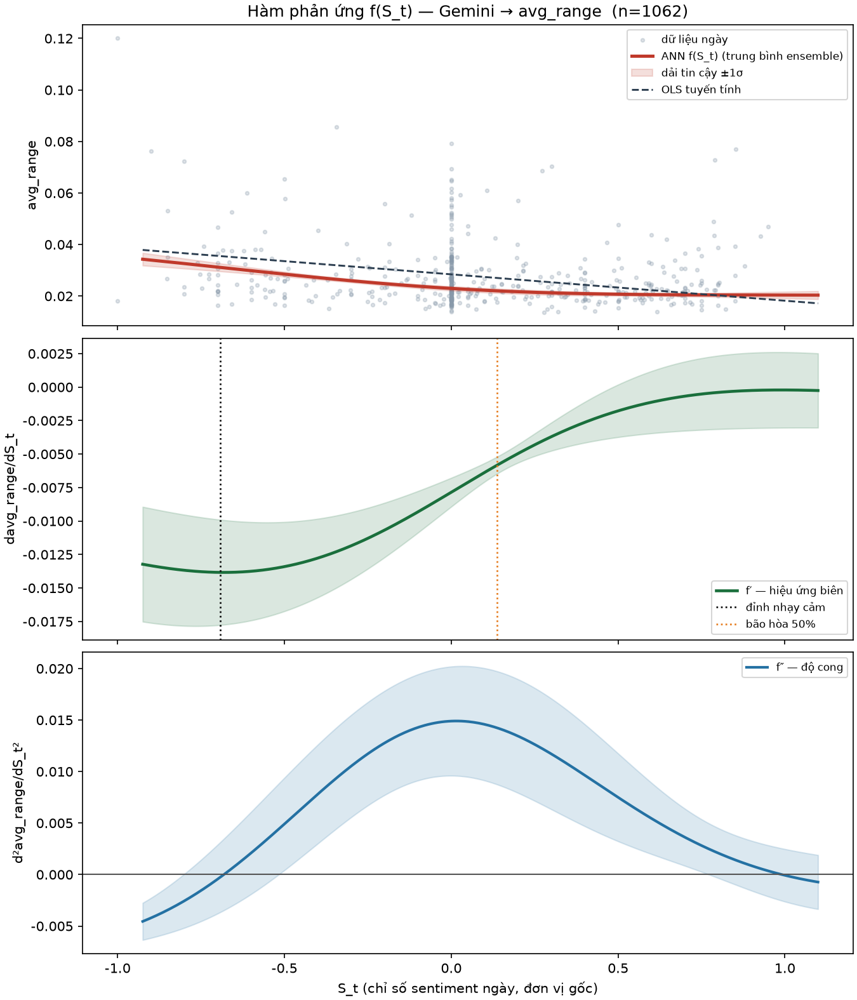
- 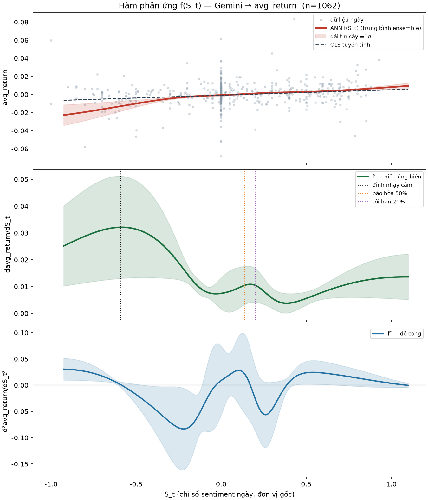
- 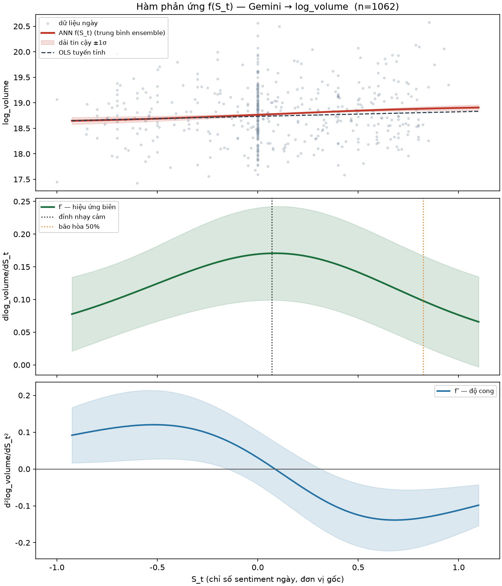
- 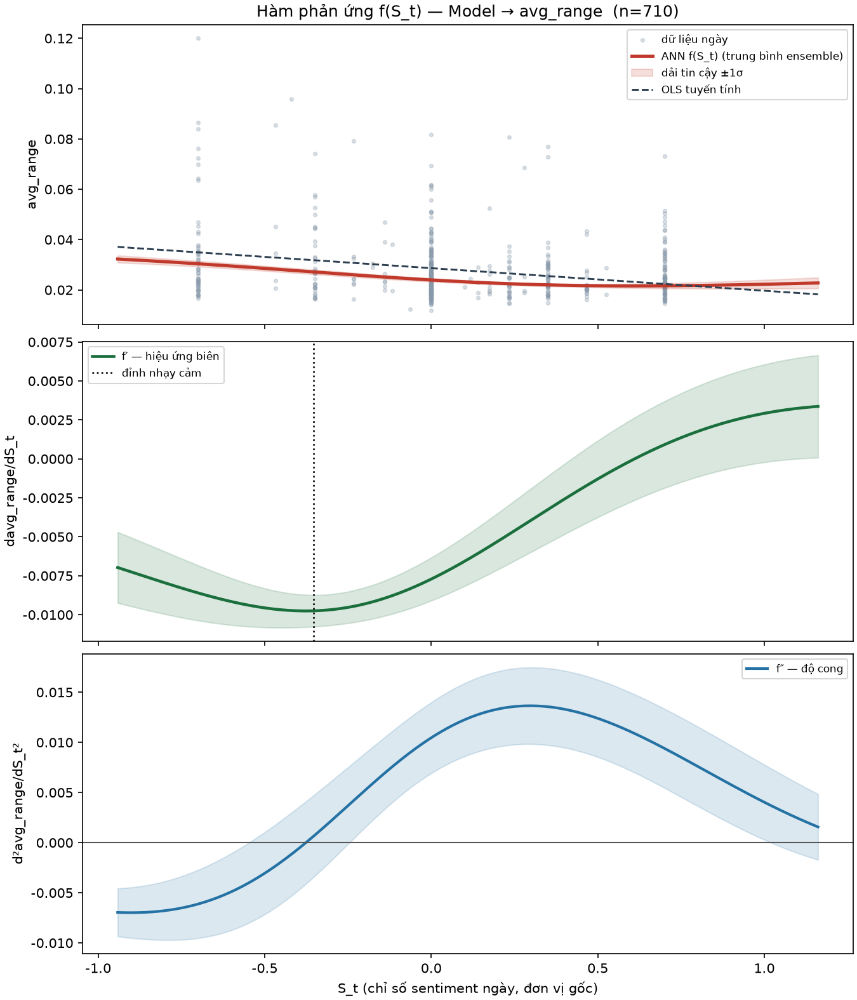
- 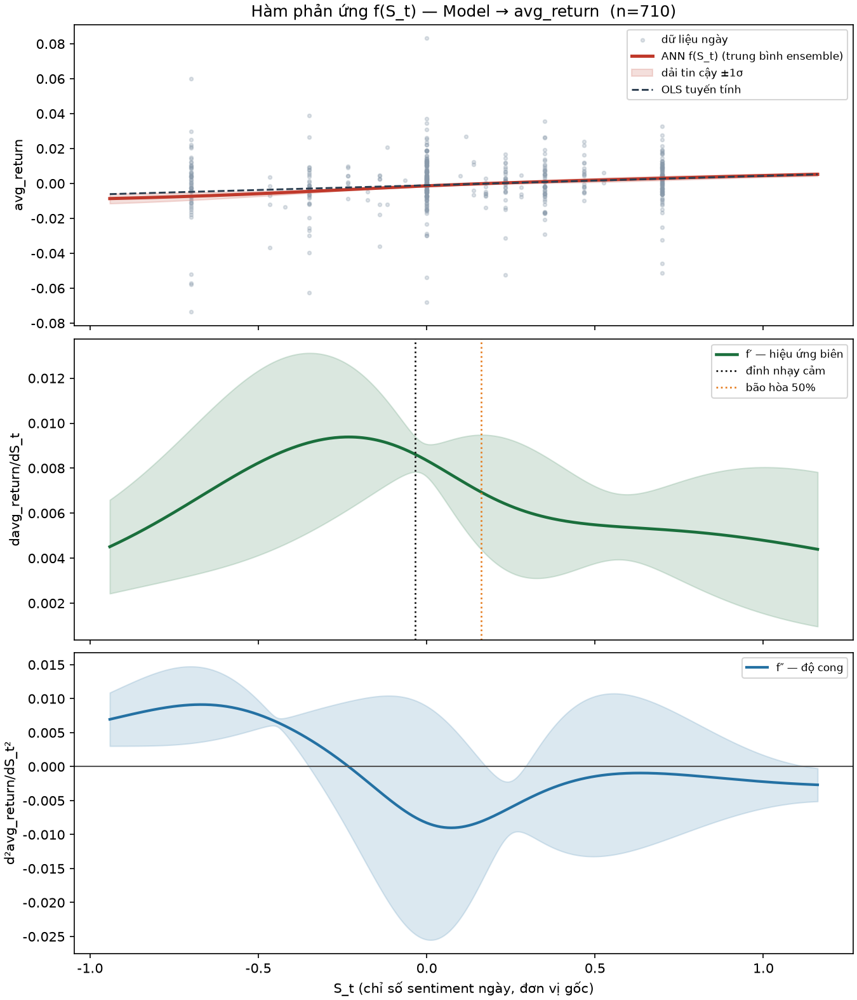
- 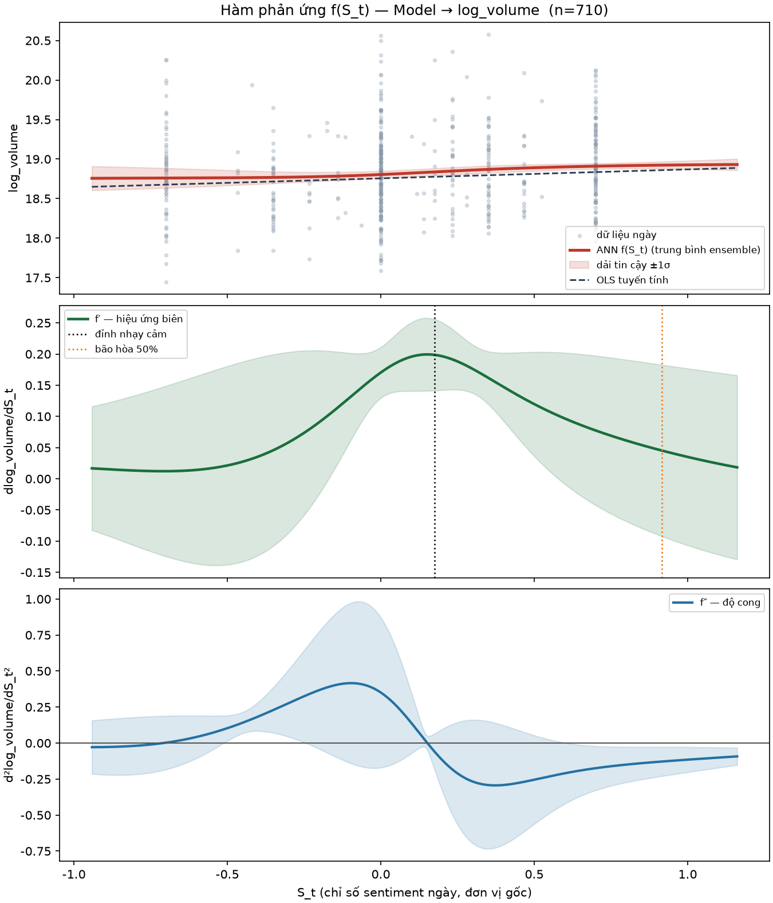

## Hình tương quan

- 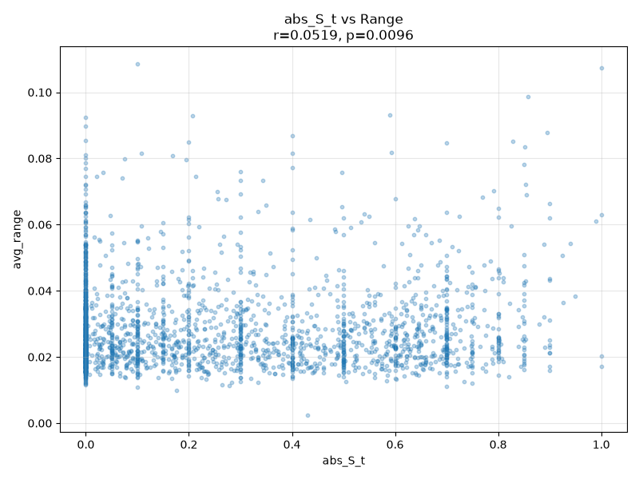
- 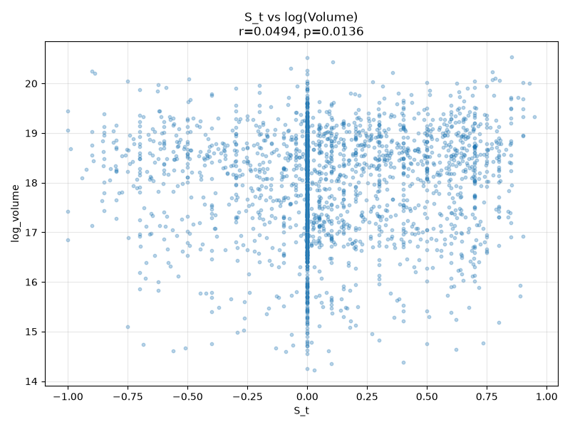
- 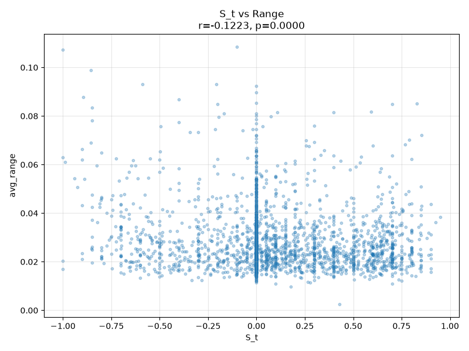
- 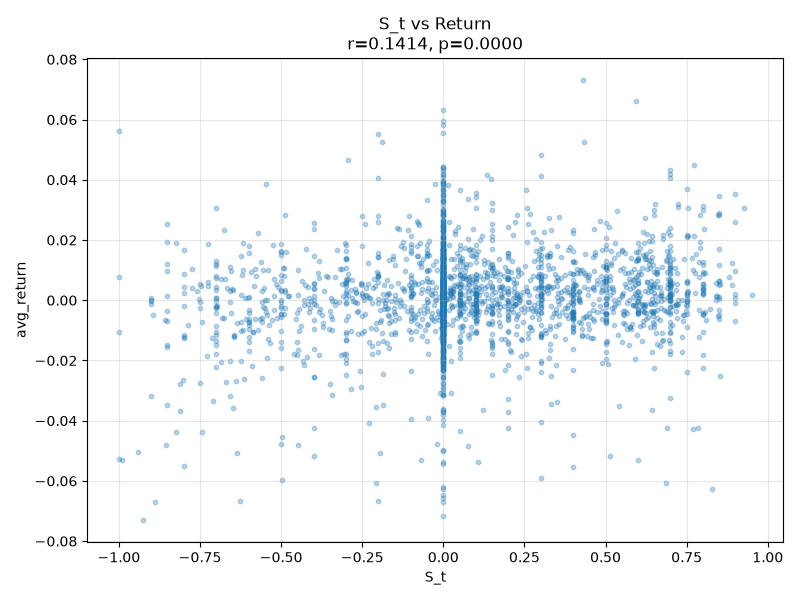
- 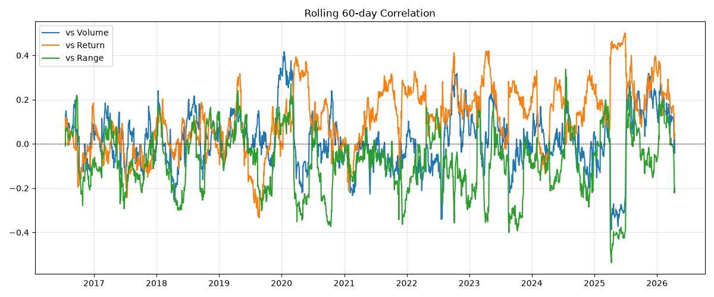